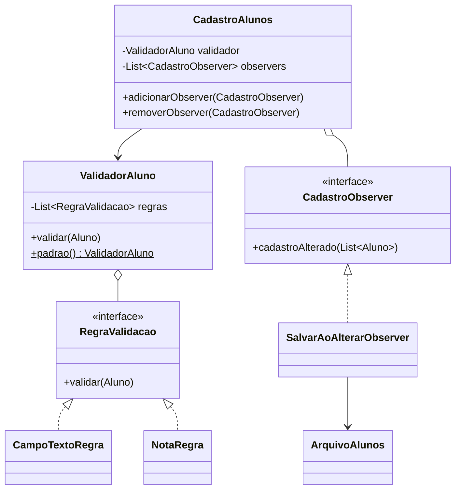

# 🎓 Sistema de Cadastro de Alunos (CRUD)

Projeto Integrador da disciplina de Programação Orientada a Objetos (MINF-0301).

Sistema feito em Java para cadastrar, listar, atualizar e deletar alunos pelo terminal. Os dados ficam salvos no arquivo `alunos.csv`, então continuam lá quando o programa é fechado e aberto de novo.

## Funcionalidades

- Cadastrar aluno (nome, matrícula, curso e nota). O ID é gerado automaticamente.
- Listar os alunos na ordem em que foram cadastrados
- Atualizar os dados de um aluno pelo ID
- Deletar um aluno pelo ID
- Salvar tudo no `alunos.csv` a cada alteração e carregar esse arquivo quando o programa abre

Regras:

- Nome, matrícula e curso não podem ficar vazios
- A nota tem que estar entre 0 e 10 (pode digitar com ponto ou vírgula, ex.: `7.5` ou `7,5`)
- Não pode ter dois alunos com a mesma matrícula
- Se a pessoa digitar letra onde era número, o programa avisa e pergunta de novo

## Estrutura do projeto

```
Projeto-CRUD/
├── README.md
├── .gitignore
└── CadastroAlunos.java/                  # pasta do projeto no VS Code
    ├── .vscode/settings.json             # diz ao VS Code onde ficam src, test e lib
    ├── lib/
    │   └── junit-platform-console-standalone.jar   # JUnit 5
    ├── src/
    │   ├── app/Main.java                 # inicia o programa e liga as peças
    │   ├── model/Aluno.java              # dados do aluno
    │   ├── controller/CadastroAlunos.java  # regras e operações do CRUD (sujeito do Observer)
    │   ├── validation/                   # Strategy: regras de validação
    │   ├── observer/CadastroObserver.java  # Observer: interface de quem quer ser avisado
    │   ├── persistence/                  # leitura/escrita do alunos.csv + observer que salva
    │   ├── exception/                    # exceções do sistema
    │   └── view/Menu.java                # menu e leitura do teclado
    └── test/
        ├── controller/                   # CadastroAlunosTest, CadastroComArquivoTest, CadastroComValidadorTest, CadastroObserverTest
        ├── persistence/                  # ArquivoAlunosTest, SalvarAoAlterarObserverTest
        └── validation/                   # RegrasValidacaoTest, ValidadorAlunoTest
```

## Instalação

1. Instale o **Java JDK 17 ou mais novo** (por exemplo, o Eclipse Temurin, em https://adoptium.net). Pra conferir, abra o terminal e rode `java -version` e `javac -version`: os dois têm que mostrar a versão 17 ou maior.
2. (Opcional) Instale o **VS Code** com a extensão **Extension Pack for Java**, que já traz o executor de testes.
3. Baixe o projeto:

   ```
   git clone https://github.com/Fred-nbb/Projeto-CRUD.git
   ```

   ou, na página do repositório no GitHub, clique em **Code > Download ZIP** e extraia.

Não precisa instalar mais nada: o JUnit já vem dentro da pasta `lib`.

## Compilação e execução

**Pelo VS Code**

1. Abra a pasta `CadastroAlunos.java` (Arquivo > Abrir Pasta). Tem que ser essa pasta, e não a `Projeto-CRUD`, porque a configuração do projeto está dentro dela.
2. Abra `src/app/Main.java` e clique em **Run**, em cima do `main`.

**Pelo terminal**, dentro da pasta `CadastroAlunos.java`:

```
javac -encoding UTF-8 -d bin -sourcepath src src/app/Main.java
java -cp bin app.Main
```

O arquivo `alunos.csv` é criado na pasta de onde o programa foi executado.

## Como rodar os testes

Os testes usam JUnit 5 e ficam na pasta `test`. O jar do JUnit já vem na pasta `lib`, então não precisa baixar nada.

**Pelo VS Code**: abra o painel **Testing** (ícone de tubo de ensaio na barra lateral) e clique em **Run Tests**. Também dá pra rodar um teste só, pelo botão que aparece do lado de cada `@Test`.

**Pelo terminal**, dentro da pasta `CadastroAlunos.java`:

Windows (PowerShell):

```powershell
javac -encoding UTF-8 -d bin -cp lib/junit-platform-console-standalone.jar -sourcepath src (Get-ChildItem -Recurse test -Filter *.java).FullName
java -jar lib/junit-platform-console-standalone.jar execute -cp bin --scan-classpath
```

Linux ou macOS:

```bash
javac -encoding UTF-8 -d bin -cp lib/junit-platform-console-standalone.jar -sourcepath src $(find test -name "*.java")
java -jar lib/junit-platform-console-standalone.jar execute -cp bin --scan-classpath
```

São 55 testes:

- `CadastroAlunosTest`: cadastro, listagem, atualização, remoção e as validações (campo vazio, nota fora de 0 a 10, matrícula repetida, ID que não existe).
- `ArquivoAlunosTest`: salvar e ler o arquivo, arquivo que ainda não existe, linha com erro e cópia de segurança.
- `CadastroComArquivoTest`: testa o cadastro junto com o arquivo, como se o programa fosse fechado e aberto de novo. Confere que os alunos voltam, que a atualização e a remoção continuam valendo e que os IDs continuam de onde pararam.
- `RegrasValidacaoTest`, `ValidadorAlunoTest` e `CadastroComValidadorTest`: testam cada regra de validação sozinha, a ordem em que elas são conferidas e a troca de regras no cadastro (padrão Strategy).
- `CadastroObserverTest` e `SalvarAoAlterarObserverTest`: conferem quando os observers são avisados (e quando não são) e se o arquivo é atualizado sozinho a cada alteração (padrão Observer).

## Padrões de projeto (Etapa 5)

Foram aplicados dois padrões GoF, escolhidos por problemas que o código tinha de verdade:

| Padrão | Tipo | Problema que tinha no código | Onde está |
|---|---|---|---|
| **Strategy** | comportamento | as regras de validação eram métodos fixos dentro do `CadastroAlunos` | pacote `validation` |
| **Observer** | comportamento | o `Menu` tinha que lembrar de salvar o arquivo depois de cada operação | pacote `observer` + `persistence/SalvarAoAlterarObserver` |



### Strategy: regras de validação

**Problema.** Na versão anterior, `validarDados` e `validarTexto` ficavam dentro do `CadastroAlunos`, junto com as regras do CRUD. Toda regra nova (por exemplo, limitar o tamanho do nome) obrigava a mexer nessa classe. Ela também importava o `ArquivoAlunos` só para saber qual era o caractere `;`.

**Solução.** Cada regra virou uma classe que implementa a interface `RegraValidacao` (a estratégia):

- `CampoTextoRegra`: o campo não pode ser vazio nem ter `;`. A mesma classe serve para nome, matrícula e curso.
- `NotaRegra`: a nota tem que estar entre 0 e 10.

O `ValidadorAluno` (o contexto) recebe uma lista de regras e chama `validar` em cada uma, na ordem, parando na primeira que falhar. O `CadastroAlunos` só conhece o `ValidadorAluno`.

**Por que é adequado.** As regras de validação mudam com mais frequência que o resto do CRUD, e todas têm o mesmo formato (recebem um aluno e lançam `DadosInvalidosException` se ele for inválido). Com o Strategy dá para adicionar, tirar ou trocar regras sem mexer no `CadastroAlunos`. Os testes fazem isso: um cadastro com validador sem nenhuma regra e outro com uma regra nova escrita como lambda.

```java
// o validador do sistema (ValidadorAluno.padrao())
new ValidadorAluno(List.of(
        new CampoTextoRegra("nome", Aluno::getNome, ";"),
        new CampoTextoRegra("matrícula", Aluno::getMatricula, ";"),
        new CampoTextoRegra("curso", Aluno::getCurso, ";"),
        new NotaRegra()));

// um cadastro com outras regras, sem alterar o CadastroAlunos
CadastroAlunos cadastro = new CadastroAlunos(new ValidadorAluno(List.of(new NotaRegra())));
```

### Observer: salvar o arquivo quando o cadastro muda

**Problema.** O `Menu` chamava `salvarDados()` em três lugares (depois de cadastrar, atualizar e deletar). Se alguém criasse outra tela ou esquecesse essa chamada, as alterações não iam para o arquivo. Além disso, o menu (camada de visão) conhecia a camada de persistência para salvar.

**Solução.** O `CadastroAlunos` é o objeto observado: ele tem uma lista de `CadastroObserver` e, depois de cada cadastro, atualização ou remoção que deu certo, chama `cadastroAlterado(alunos)` em todos. Quem salva é o `SalvarAoAlterarObserver`, registrado no `Main`:

```java
cadastro.adicionarObserver(new SalvarAoAlterarObserver(arquivo, System.out::println));
```

O `Menu` não salva mais nada. Se o arquivo não puder ser salvo, o observer mostra o mesmo aviso de antes e a alteração continua valendo na memória.

**Por que é adequado.** "Fazer algo quando o cadastro muda" é exatamente o problema do Observer. O cadastro não precisa saber o que acontece depois da alteração, então dá para ligar outras reações (um histórico de alterações, por exemplo) criando um novo observer, sem mexer no cadastro nem no menu.

Detalhes que foram pensados:

- Erros (matrícula repetida, dado inválido, ID que não existe) não avisam os observers, porque nada mudou.
- `carregarAlunos` (que lê o arquivo ao abrir o programa) também não avisa, senão o sistema salvaria de volta o que acabou de ler.
- A lista enviada aos observers não pode ser modificada, então um observer não atrapalha os outros nem o cadastro.

## Javadoc

Todas as classes, construtores e métodos públicos têm Javadoc. Para gerar a documentação em HTML, dentro da pasta `CadastroAlunos.java`:

```
javadoc -encoding UTF-8 -docencoding UTF-8 -charset UTF-8 -d docs -sourcepath src -subpackages app:controller:exception:model:observer:persistence:validation:view
```

Depois é só abrir o arquivo `docs/index.html` no navegador. A pasta `docs` não vai pro Git (está no `.gitignore`), porque dá pra gerar de novo quando precisar.

## O que foi usado em cada parte

### Exceções

Ficam no pacote `exception` e todas são filhas de `CadastroException`:

| Exceção | Quando acontece | Exemplo de mensagem |
|---|---|---|
| `AlunoNaoEncontradoException` | o ID digitado não existe | Nenhum aluno encontrado com o ID 7. |
| `DadosInvalidosException` | campo vazio, nota fora de 0 a 10 ou `;` no texto | A nota deve estar entre 0 e 10. |
| `MatriculaDuplicadaException` | a matrícula já é de outro aluno | Já existe um aluno com a matrícula 2026001. |

O `Menu` trata todas com um único `catch (CadastroException e)` e mostra a mensagem pro usuário.

Se o `alunos.csv` estiver com algum problema (por exemplo, uma nota que não é número), a leitura gera uma `IOException` dizendo qual linha está errada. Nesse caso o programa salva uma cópia em `alunos.csv.bak` antes de continuar, pra não perder os dados.

### Coleções

Usadas na classe `CadastroAlunos`:

- `Map<Integer, Aluno>` (`LinkedHashMap`): acha o aluno pelo ID direto e mantém a ordem de cadastro.
- `Set<String>` (`HashSet`): guarda as matrículas e não deixa ter repetidas.
- `List<Aluno>`: é o que `listarAlunos()` devolve, e é o que vai pro arquivo e volta dele.

### Arquivo

A classe `ArquivoAlunos` usa `BufferedWriter` e `BufferedReader` (de `java.nio.file.Files`) com try-with-resources, que fecha o arquivo mesmo se der erro. O `alunos.csv` fica assim:

```
id;nome;matricula;curso;nota
1;Maria Silva;2026001;Ciência da Computação;8.5
```

### Código sem duplicação

- A leitura do teclado fica toda em `lerTexto`, `lerInteiro` e `lerNota` (no `Menu`).
- A validação dos dados fica toda no `ValidadorAluno` (padrão Strategy), usado pelo cadastro, pela atualização e pelo carregamento do arquivo.
- O salvamento no arquivo fica num lugar só, o `SalvarAoAlterarObserver` (padrão Observer), em vez de uma chamada em cada operação do menu.
- Um único método (`adicionar`) coloca o aluno nas coleções.

## Integrantes

- Daniel Barros Duarte da Silva
- João Gabriel Silva Santiago
- José Bezerra Sandes Neto
- Frederico Nogueira Brasil Bezerra
